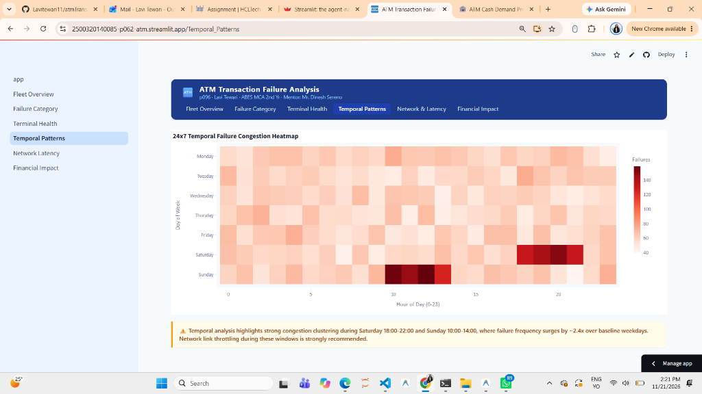
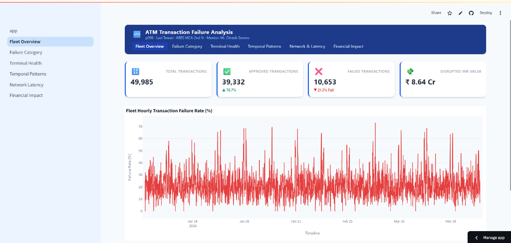
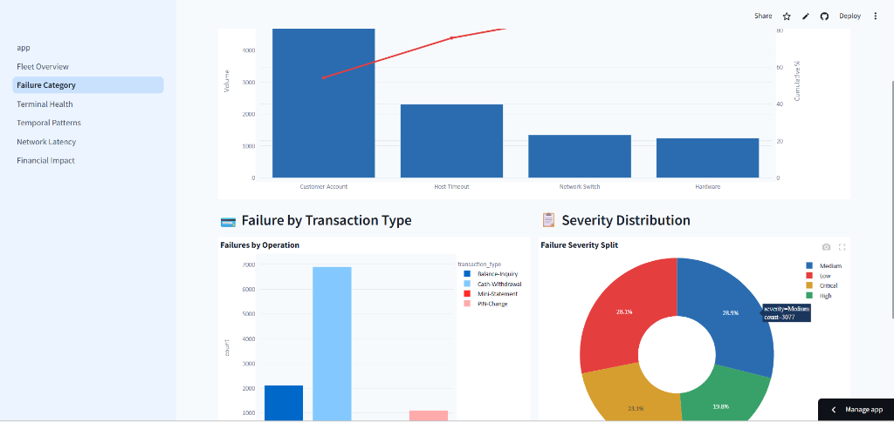
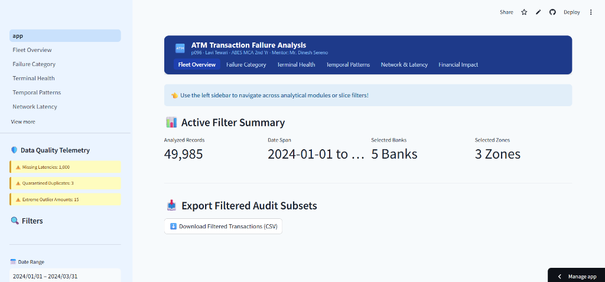

<div align="center">
  
  <h2>HCLTech Career Shaper Programme | ABES Engineering College</h2>
  <h1>p096: ATM Transaction Failure Analysis</h1>
</div>

[](https://www.python.org/)
[](https://2500320140085-p062-atm.streamlit.app/)
[](https://pytest.org/)
[]()

**Live Web Application:** [https://2500320140085-p062-atm.streamlit.app/](https://2500320140085-p062-atm.streamlit.app/)  
**GitHub Repository:** [https://github.com/Lavitewari11/atmTransaction](https://github.com/Lavitewari11/atmTransaction)  
**Learner:** Lavi Tewari (Roll No: 2500320140085), MCA 2nd Year Data Analytics, ABES Engineering College  
**Mentor:** Mr. Dinesh Sereno  

---

## 📸 Live Application Screenshots

### 1. Live Deployment on Streamlit Cloud (24×7 Temporal Failure Heatmap)


### 2. Fleet Overview & KPI Telemetry


### 3. Failure Root-Cause & Severity Analysis


### 4. Application Home & Active Filter Telemetry


---

## 🏧 Executive Overview
Automated Teller Machine (ATM) terminal downtime and recurring transaction failures (technical timeouts, cash dispenser jams, switch link outages) reduce transaction success rates below banking service-level agreements (< 95% SLA), erode customer trust, and inflate maintenance costs.

Project **p096** delivers an end-to-end interactive data analytics dashboard built with **Python**, **Streamlit**, and **Plotly**, powered by an embedded **SQLite** relational database (`data/app.db`) containing 50,003 multi-bank records across 200 ATM terminals.

---

## 🚀 Key Features & Analytical Modules
1. **Fleet Health Overview (`pages/01_Fleet_Overview.py`):** Real-time KPI summaries, hourly failure trend curves, and baseline fleet health tracking.
2. **Failure Root-Cause Taxonomy (`pages/02_Failure_Category.py`):** Pareto 80/20 analysis decomposing failures into Hardware, Network-Switch, Customer-Account, and Host Timeout.
3. **Terminal Health & Anomaly Detection (`pages/03_Terminal_Health.py`):** Automated ranking of chronic outlier terminals exceeding the 5.0% SLA threshold, with MTBF calculations and vendor benchmarking.
4. **Temporal Patterns (`pages/04_Temporal_Patterns.py`):** 24×7 failure congestion density heatmap exposing peak weekend outages.
5. **Network Latency Analysis (`pages/05_Network_Latency.py`):** Statistical scatter correlation proving response latency > 3,500 ms triggers 100% timeouts, plus On-Us vs. Off-Us Z-test.
6. **Financial Impact (`pages/06_Financial_Impact.py`):** Treemaps and financial cards quantifying gross transaction INR at risk.

---

## 🛠️ Installation & Execution

```bash
# 1. Clone repository & navigate
git clone <repo-url>
cd AtmTransactionAnalysis

# 2. Create and activate virtual environment
python -m venv .venv
.venv\Scripts\activate   # Windows

# 3. Install pinned dependencies
pip install -r requirements.txt

# 4. Run automated test suite (11 unit tests)
pytest -v

# 5. Launch interactive analytics dashboard
streamlit run app.py
```

---

## 📁 Repository Structure
```text
AtmTransactionAnalysis/
├── app.py                         # Streamlit entry point & global filter router
├── pages/                         # 6 Multi-page diagnostic views
├── src/                           # Backend logic (db.py, transform.py, analysis.py, charts.py, ui.py)
├── data/                          # SQLite app.db (4 tables + 1 view) and raw CSVs
├── tests/                         # pytest test fixtures and assertions (11 tests)
├── docs/                          # Complete academic Word, Excel, and Presentation deliverables
├── requirements.txt               # Pinned package manifest
└── README.md
```
